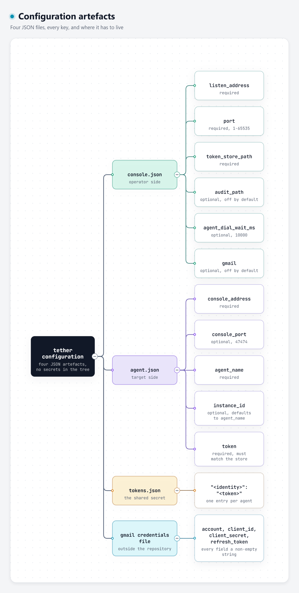

# Configuration reference

Every configuration artefact tether reads, every key, its default, and the
exact error text a bad value produces.

All configuration files are **JSON objects**. Every problem is an explicit
failure that names the file — and the field, where the problem is field-level.
The loaders never substitute silent defaults for a malformed file.

---

## 1. The console config

Parsed by `load_console_config()` (`lib/common/config.cpp`).

```
{
    "listen_address": "0.0.0.0",
    "port": 47474,
    "token_store_path": "/etc/tether/tokens.json",
    "audit_path": "/var/lib/tether/audit.jsonl",
    "agent_dial_wait_ms": 10000,
    "gmail": null
}
```

Template: [`docs/examples/console.example.json`](examples/console.example.json).

| Key | Type | Required | Default | Meaning |
| --- | --- | :---: | --- | --- |
| `listen_address` | string | **yes** | — | The address the console binds. An empty string is replaced with `127.0.0.1` at startup. |
| `port` | integer | **yes** | — | The listening port, in `[1, 65535]`. `0` at runtime means an ephemeral port (only reachable via the missing-file fallback). |
| `token_store_path` | string | **yes** | — | Path to the JSON token store. Must be non-empty. |
| `audit_path` | string or null | no | absent / null / `""` ⇒ **off** | The JSONL audit trail file. A set path turns console-side audit records on. |
| `agent_dial_wait_ms` | integer ≥ 0 | no | **10000** | How long one invocation waits for the agent's dial-in before the unknown-agent refusal. `0` disables the wait. |
| `gmail` | object or null | no | absent / null ⇒ **off** | The optional slow-path transport section (§4). |

### Validation and error text

| Problem | Message |
| --- | --- |
| File missing or unreadable | `<path>: cannot open config file (missing or unreadable)` |
| Malformed JSON | `<path>: malformed JSON (<nlohmann what()>)` |
| Root is not an object | `<path>: config root must be a JSON object` |
| Missing required field | `<path>: missing required field '<field>'` |
| Wrong type | `<path>: field '<field>' must be a string` / `... must be an integer` |
| Port out of range | `<path>: field 'port' must be an integer in [1, 65535]` |
| Empty token-store path | `<path>: field 'token_store_path' must be a non-empty path` |
| Bad `audit_path` | `<path>: field 'audit_path' must be a string` |
| Bad `agent_dial_wait_ms` | `<path>: field 'agent_dial_wait_ms' must be a non-negative integer` |

### The missing-file fallback

If the console config file **does not exist**, the console does not abort. It
falls back to a default-constructed config:

- `listen_address` → `127.0.0.1`
- `port` → `0` (ephemeral)
- `token_store_path` → `""` ⇒ **no token store** ⇒ every agent is refused at
  the handshake
- `agent_dial_wait_ms` → `10000`

Any *other* config problem (malformed JSON, a missing field, a bad type) is a
hard failure. Only "the file is absent" is a fallback.

---

## 2. The agent config

Parsed by `load_agent_config()` (`lib/common/config.cpp`).

```
{
    "console_address": "10.0.0.5",
    "console_port": 47474,
    "agent_name": "lab-1",
    "instance_id": "lab-1",
    "token": "..."
}
```

Template: [`docs/examples/agent.example.json`](examples/agent.example.json).

| Key | Type | Required | Default | Meaning |
| --- | --- | :---: | --- | --- |
| `console_address` | string | **yes** | — | The address the agent dials out to. |
| `console_port` | integer | no | **47474** | The console's port, in `[1, 65535]`. |
| `agent_name` | string | **yes** | — | The registry identity. The console addresses the agent by exactly this string. |
| `instance_id` | string | no | `agent_name` | The install-specific instance id carried in `HELLO`. |
| `token` | string | **yes** (may be empty) | — | The pre-shared token for the HMAC handshake. |

### The `token` field

An empty `token` is **structurally valid** at load time — the root
`agent.example.json` ships that way. The refusal happens later, at the
session:

```
refusing to dial out with an empty provisioned token
```

That refusal is a thrown `SessionError`, and the agent's main loop does **not**
catch it (it catches `ConfigError` and `TransportError` only), so the process
terminates abnormally rather than exiting cleanly with a structured message.
The fix is to put the same token in the agent config and in the console's
token store.

### `instance_id` is read leniently

`instance_id` is read **only if it is a JSON string**; a non-string value is
silently ignored rather than raising a `ConfigError`. Every other field
errors on a wrong type. This is an inconsistency in the loader, not a
documented feature.

### Error text

| Problem | Message |
| --- | --- |
| File missing or unreadable | `<path>: cannot open config file (missing or unreadable)` |
| Malformed JSON | `<path>: malformed JSON (<nlohmann what()>)` |
| Root is not an object | `<path>: config root must be a JSON object` |
| Missing required field | `<path>: missing required field '<field>'` |
| Wrong type | `<path>: field '<field>' must be a string` / `... must be an integer` |
| Port out of range | `<path>: field 'console_port' must be an integer in [1, 65535]` |

---

## 3. The token store

Read by the console at startup (`console/main.cpp`). A JSON object mapping an
agent identity to its pre-shared token.

```
{
    "lab-1": "3f9c1d7e5b2a8046c1f9e0d3b7a4c5e2d8b6f1a0c3e7d9b4f2a6c8e0d1b3f5a7",
    "lab-2": "9a1c4e7b2d8f0356a9c2e7b4d1f8a0356c9e2b7d4f1a8c3e6b9d2f5a8c1e4b7d"
}
```

Template: [`docs/examples/tokens.example.json`](examples/tokens.example.json).

| Problem | Message |
| --- | --- |
| The file exists but cannot be opened | `token store '<path>' cannot be opened` |
| Root is not an object | `token store '<path>' must be a JSON object of agent names to tokens` |
| A value is not a string | `token store '<path>' entry '<key>' is not a string` |

### Semantics

- A **missing** token-store file is **not** an error: the console silently
  treats it as an empty store, and every agent is then refused at the
  handshake with `unknown agent identity '<x>'`.
- A **malformed** token-store file raises a raw JSON parse error rather than a
  `ConfigError` — the store is parsed with `nlohmann::json::parse` outside the
  config loader's error handling.
- An identity that is **not** in the store is refused at the handshake,
  **before** any challenge is issued — the agent learns nothing verifiable.
- A store whose value is the empty string is treated as "no token": the agent
  is refused the same way an unknown identity is.
- The token is compared through the HMAC handshake, not by string equality.

---

## 4. The Gmail section (optional, off by default)

Nested under `gmail` in the console config.

```
{
    "gmail": {
        "enabled": true,
        "credentials_path": "/etc/tether/gmail-credentials.json",
        "poll_interval_seconds": 30,
        "admin_list": ["admin@example.com"],
        "default_agent": "lab-1"
    }
}
```

| Key | Type | Required | Default | Meaning |
| --- | --- | :---: | --- | --- |
| `enabled` | boolean | **yes** (when the section is present and non-null) | `false` | Turns the adapter on for this console. |
| `credentials_path` | non-empty string | only when `enabled` | — | The OAuth credentials file, **outside the repository**. |
| `poll_interval_seconds` | integer ≥ 1 | only when `enabled` | — | The inbox polling cadence. |
| `admin_list` | non-empty array of non-empty strings | only when `enabled` | — | The sender allowlist. Mail from anyone else is ignored — **never executed**. |
| `default_agent` | non-empty string | only when `enabled` | — | The identity that mail-issued commands route to when the body carries no explicit `agent` selector. |

When `enabled` is `false`, **none** of the other fields are parsed or
validated — the section is structured but off.

### Error text

| Problem | Message |
| --- | --- |
| Not an object | `<path>: field 'gmail' must be an object` |
| `enabled` not a boolean | `<path>: field 'gmail.enabled' must be a boolean` |
| Missing a required gmail field | `<path>:gmail: missing required field '<field>'` |
| Bad `credentials_path` | `<path>: field 'gmail.credentials_path' must be a non-empty path` |
| Bad `poll_interval_seconds` | `<path>: field 'gmail.poll_interval_seconds' must be an integer` |
| Interval below 1 | `<path>: field 'gmail.poll_interval_seconds' must be at least a whole second` |
| Bad `admin_list` | `<path>: field 'gmail.admin_list' must be a non-empty array of addresses` |
| A bad list entry | `<path>: every gmail.admin_list entry must be a non-empty string` |
| Bad `default_agent` | `<path>: field 'gmail.default_agent' must be a non-empty identity` |

### The Gmail credentials file

Read by `load_gmail_credentials()` (`lib/transport/gmail.cpp`). Every field
must be a non-empty string:

```
{
    "account": "tether-relay@example.com",
    "client_id": "....apps.googleusercontent.com",
    "client_secret": "....",
    "refresh_token": "...."
}
```

The credentials file lives at an operator-chosen path **outside the
repository**. Nothing in this tree holds a secret. See
[readiness-decisions.md](readiness-decisions.md) for the policy verification
record.

### Current wiring status

The shipped `tether-console` binary constructs the **TCP** transport
directly. The `gmail` section is parsed and validated, but the binary does
not yet construct the adapter. The adapter itself is fully implemented and
tested (`tests/gmail_test.cpp`, `tests/transport_equiv_test.cpp`) and a
Gmail-enabled config builds it exactly once through
`build_console_transports()`.

---

## 5. Environment variables

| Variable | Used by | Meaning |
| --- | --- | --- |
| `TETHER_AGENT_EXE` | `tests/tcp_loopback_test.cpp` | Overrides the path to the `tether-agent` binary the loopback suite spawns. |
| `TETHER_PROBE_EXE` | `tests/process_family_test.cpp`, `tests/app_family_test.cpp`, `tests/families_e2e_test.cpp` | Overrides the path to the `tether-argv-probe` helper child. |

### Environment variables the production binaries read

The shipped binaries read a small, fixed set of standard environment
variables to locate per-user resources. They are read once at startup and are
never credentials:

| Variable | Read by | Meaning |
| --- | --- | --- |
| `APPDATA` | `lib/syscalls/app.cpp` | The per-user Start-menu root on Windows. Absent ⇒ that root contributes nothing. |
| `ProgramData` | `lib/syscalls/app.cpp` | The machine-wide Start-menu root on Windows. |
| `XDG_DATA_HOME` | `lib/syscalls/app.cpp` | The per-user `.desktop` root on Linux. |
| `XDG_DATA_DIRS` | `lib/syscalls/app.cpp` | The machine-wide `.desktop` roots on Linux. |
| `HOME` | `lib/syscalls/app.cpp` | The fallback per-user `.desktop` root on Linux. |
| `XDG_SESSION_TYPE` | `lib/syscalls/input.cpp` | The input-family environment probe: `wayland` vs `x11`. |

Nothing else in the tree reads the environment, and no credential is ever
taken from it.

---

## 6. File layout conventions

| Artefact | Conventional location | Notes |
| --- | --- | --- |
| Console config | `/etc/tether/console.json` | Operator's choice. |
| Agent config | `/etc/tether/agent.json` | On the target machine. |
| Token store | `/etc/tether/tokens.json` | Mode `0600` — it holds shared secrets. |
| Audit trail | `/var/lib/tether/audit.jsonl` | One JSON object per line, append-only. |
| Gmail credentials | `/etc/tether/gmail-credentials.json` | Outside the repository. Mode `0600`. |

The repository ships **templates only** — `docs/examples/*.example.json` and
the root `console.example.json` / `agent.example.json`. None of them contains
a real secret, and none of them should be edited in place; copy them out.

---

## 7. Quick reference



*Interactive version: [config-layout.html](diagrams/config-layout.html).*

