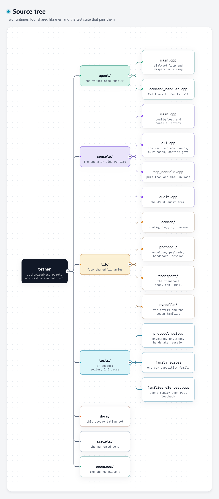

# Developer guide

The source tree, per-module walkthrough, coding conventions, and step-by-step
recipes for the changes you are most likely to make.

---

## 1. Source tree



*Interactive version: [source-tree.html](diagrams/source-tree.html).*

### Line counts by area

| Area | Source files | Rough size |
| --- | ---: | ---: |
| `lib/protocol` | 10 | ~2,000 lines |
| `lib/syscalls` | 21 | ~4,500 lines |
| `lib/transport` | 7 | ~2,400 lines |
| `lib/common` | 6 | ~700 lines |
| `console` | 7 | ~1,900 lines |
| `agent` | 3 | ~450 lines |
| `tests` | 29 | ~9,000 lines |

(File counts exclude each area's `CMakeLists.txt`.)

---

## 2. Module walkthrough

### `lib/common` — config, logging, base64

| File | What it holds |
| --- | --- |
| `config.hpp/.cpp` | `ConsoleConfig`, `AgentConfig`, `GmailSectionConfig`, `ConfigError`, `load_console_config`, `load_agent_config`. |
| `logging.hpp/.cpp` | `LogLevel`, `LogField`, `LogRecord`, `LogSink`, `StreamLogSink`, `Logger`, `format_log_record`. |
| `base64.hpp/.cpp` | `base64_encode`, `base64_decode`, `base64_encode_string`, `base64_decode_string`, `Base64Error`. |

**Base64 is not part of the protocol wire format.** The protocol uses hex for
the nonce and the HMAC. Base64 exists for the Gmail transport (MIME bodies and
the `raw` upload).

### `lib/protocol` — the wire

| File | What it holds |
| --- | --- |
| `bytes.hpp` | `ReadResult`, `IByteSource`, `IByteSink`, `InMemoryPipe`, `InMemoryConnection`. The seam between the protocol and any byte stream. |
| `envelope.hpp/.cpp` | `kEnvelopeVersion` (2), `kEnvelopeHeaderBytes` (10), `kMaxControlPayloadBytes` (1 MiB), `kMaxFileChunkBytes` (256 KiB), `MsgType`, `Frame`, `encode_frame`, `FrameDecoder`, `ProtocolError`. |
| `payloads.hpp/.cpp` | The 12 payload structs, the `Message` variant, `encode_payload`, `decode_payload`, `message_type_of`. |
| `handshake.hpp/.cpp` | `hmac_sha256`, `hmac_sha256_hex`, `generate_nonce_hex`, `is_valid_nonce_hex`, `Challenger`, `Responder`, `HandshakeFailure`. |
| `session.hpp/.cpp` | `SessionState`, `SessionConfig`, `ConsoleSession`, `AgentSession`, `AgentRegistry`, `CommandView`, `CommandStatus`. |
| `protocol.hpp` | The umbrella header. |

### `lib/transport` — the pipes

| File | What it holds |
| --- | --- |
| `transport.hpp/.cpp` | `ITransport`, `TransportError`, `TransportMillis`, `monotonic_now_ms`, `build_console_transports`. |
| `tcp.hpp/.cpp` | `TcpByteStream`, `TcpConsoleTransport`, `TcpAgentLink`, `DialPolicy`, `establish_with_retries`, `next_backoff_ms`. |
| `gmail.hpp/.cpp` | `GmailTransport`, `GmailClient`, `HttpClient`, `PollScheduler`, the MIME renderer, the acceptance rule. |
| `gmail_cpr.cpp` | The only file that includes `<cpr/cpr.h>`: `CprHttpClient` and `GoogleGmailClient`. |

### `lib/syscalls` — the capabilities

| File | What it holds |
| --- | --- |
| `matrix.hpp/.cpp` | `Family`, `Platform`, `CommandSpec`, `kCommandSet`, `Outcome`, `CommandDispatcher`, `kConfirmMarker`. |
| `errors.hpp` | `SyscallError` — a structured failure with a stable code. |
| `jobs.hpp/.cpp` | `JobHandle`, `BackgroundJobRegistry`, `JobDeliverable`, `shared_job_registry`. |
| `process.hpp/.cpp` | `IProcessControl`, `ProcessInfo`, `make_process_control`. |
| `file.hpp/.cpp` | `IFileSystem`, `FileEntry`, `make_file_system`. |
| `power.hpp/.cpp` | `IPowerControl`, `ILogindBinding`, `LogindPowerControl`, `ExitWindowsPowerControl`. |
| `capture.hpp/.cpp` | `IScreenCapture`, `make_screen_capture`. |
| `image_png.hpp/.cpp` | `Frame`, `encode_png_bgr`, `decode_png`, `looks_like_png`. |
| `camera.hpp/.cpp` | `IFrameSource`, `ICameraCapture`, `VideoCameraCapture`, `make_video_capture_source`. |
| `input.hpp/.cpp` | `IInputControl`, `IInputEnvironmentProbe`, `IKeyEventSource`, `IKeyCaptureSink`, `IKeyboardGuard`, `InputControl`. |
| `app.hpp/.cpp` | `IAppLauncher`, `AppEntry`, `make_app_launcher`, `parse_desktop_exec`. |

### `console` — the operator surface

| File | What it holds |
| --- | --- |
| `cli.hpp/.cpp` | `CliStreams`, `IOperConsole`, the `kExit*` exit-code constants, `run_cli`. |
| `tcp_console.hpp/.cpp` | `TcpOperConsole` — the pump loop, `wait_for_dial`, the agent-dial budget. |
| `audit.hpp/.cpp` | `AuditRecord`, `AuditQuery`, `AuditStore`, `load_audit_jsonl`, `classify_command_outcome`, `parse_job_event_line`. |

### `agent` — the target surface

| File | What it holds |
| --- | --- |
| `main.cpp` | Config load, dispatcher wiring, the dial-out and reconnect loop. |
| `command_handler.hpp/.cpp` | `install_commands`, `outcome_to_pieces`, `dispatch_and_reply`. |

---

## 3. Conventions

These are not suggestions — the code is consistent about them, and the tests
assume them.

### Naming

- Namespaces mirror directories: `tether::common`, `tether::protocol`,
  `tether::transport`, `tether::syscalls`, `tether::cli`, `tether::agent`.
  (The C++ namespace comes from the source files; there are no CMake `ALIAS`
  targets — the build target is `tether-syscalls`, the namespace is
  `tether::syscalls`.)
- CMake targets are `tether-<area>`: `tether-common`, `tether-protocol`,
  `tether-transport`, `tether-syscalls`, `tether-cli`,
  `tether-command-handler`.
- Factories are `make_<thing>()`. The syscall families return
  `std::shared_ptr<I<Thing>>`; the transport layer returns `std::unique_ptr`
  (`make_curl_http_client`, `make_google_gmail_client`).
- Interfaces are `I<Thing>`; the concrete implementations are often named
  after their platform (`WindowsProcessControl`, `LinuxProcessControl`,
  `WindowsShortcutsAppLauncher`, `DesktopEntriesAppLauncher`,
  `WinGdiScreenCapture`, `X11ScreenCapture`), and sometimes after their
  mechanism (`FilesystemControl`, `VideoCaptureSource`, `SdBusLogindBinding`).
- Free functions that belong to a family live in that family's translation
  unit.

### Headers

Every header starts with a `//` comment block that says **what the file is
for and which requirement it serves** — usually naming the task or the spec
delta. Example (`lib/syscalls/jobs.hpp`):

```
// lib/syscalls/jobs.hpp - the shared managed background-job lifecycle
// (remote-commands delta: "background jobs have a managed lifecycle"; task
// 6.6 binds it as SHARED so the 6.7 keylogger family plugs into the same
// registry, one named slot per job family).
```

Follow that pattern. It is the project's main design record.

### Errors

There are **seven** error types, and each is used for exactly one layer:

| Exception | Layer | Header |
| --- | --- | --- |
| `ConfigError` | Configuration | `lib/common/config.hpp` |
| `ProtocolError` | The wire | `lib/protocol/envelope.hpp` |
| `SessionError` | API misuse of a session | `lib/protocol/session.hpp` |
| `TransportError` | The pipe | `lib/transport/transport.hpp` |
| `SyscallError` | A capability | `lib/syscalls/errors.hpp` |
| `AuditStoreError` | The audit trail | `console/audit.hpp` |
| `CliSetupError` | Console construction | `console/cli.hpp` |

Rules:

- **Never** use a bare `throw std::runtime_error("...")`. Each layer has its
  own type, and the message should name the thing that failed.
- A refusal that crosses the wire becomes an `Outcome` with a stable
  `code`, never an exception. Exceptions are for *unexpected* failures; the
  refusal codes in the taxonomy (see
  [command-reference.md §5](command-reference.md#5-refusal-codes)) are
  *expected* outcomes.
- Every message should name what failed and why, in prose a human can act on.
  "the family is not implemented in this build yet" beats "not supported".
- `SessionError` is the one type that is *not* caught by the agent's main
  loop — an agent that hits one terminates abnormally rather than exiting
  cleanly. Handle it explicitly if you introduce a new path that can raise it.

### Comments

The code uses comments to record **why**, not **what**. A comment that
restates the next line is noise; a comment that explains a decision, a
constraint, or a trap is load-bearing. Examples from the tree:

```
// D4: HMAC over the RAW nonce bytes (the 16 decoded bytes), not their hex
// representation; keyed with the provisioned token.
```

```
// without a handler, Xlib's default one PRINTS and TERMINATES the process
```

```
// The dispatcher outlives every link, so install is safe across redials
```

### Platform seams

- Platform-specific code lives **inside the family's translation unit**, never
  in a header. `lib/syscalls/file.cpp` has no `#ifdef` at all because one
  `std::filesystem` implementation serves both OSes.
- Prefer a `#if defined(_WIN32)` block over a runtime check when the choice
  is static.
- When a runtime dependency must be optional (libsystemd), `dlopen` it and
  hand-declare the ABI slice — do not add a link-time dependency.
- Keep the Windows and Linux branches **behaviourally identical** from the
  caller's point of view: the same error codes, the same result shapes. The
  capability matrix says every verb works on both; the families must honour
  that.

### Time

**Never call `std::chrono::system_clock::now()` in a protocol or transport
path.** Time is injected:

- The protocol takes `SessionMillis now` on every `pump()`/`start()`.
- The transport takes `TransportMillis now` on every `pump()`/`issue()`.
- `monotonic_now_ms()` (`lib/transport/transport.cpp`) is the production
  source of `TransportMillis`.

This is what makes the whole test suite deterministic and sleep-free. The
protocol layer contains **no sleeps at all**. The transport layer sleeps in
exactly two places, both outside the pump: the dial-out backoff
(`establish_with_retries`) and the console's 2 ms poll interval.

### Warnings

The build is warning-clean on both platforms with `/W4 /permissive- /EHsc`
(MSVC) and `-Wall -Wextra -Wpedantic` (GCC/Clang). **Keep it that way** — a
new warning fails the CI's cleanliness expectation even if the tests pass.

### Style

- 4-space indent, no tabs. ~100-column soft limit.
- `const` wherever the value does not change; `const&` for parameters that
  are not modified and are not cheap to copy.
- Prefer `std::string_view` for non-owning views of literal data; `std::string`
  for anything that outlives the call or crosses an API boundary.
- `std::optional` for "may not be present" values; never a sentinel.
- Explicit `override` on every virtual override.
- No `using namespace` at file scope in headers.

---

## 4. Recipes

### 4.1 Add a command to the closed set

This touches four files. Do them in this order.

**Step 1 — extend the matrix** (`lib/syscalls/matrix.cpp`, `kCommandSet`):

```
{"my_verb", Family::File, false, true, true},
```

The tuple is `{verb, family, destructive, on_windows, on_linux}`. If the
command is destructive, set `destructive = true` — the agent gate applies
automatically.

**Step 2 — wire the family slot** (if it is a new family): add the interface
in `lib/syscalls/<family>.hpp`, the implementation in
`lib/syscalls/<family>.cpp`, a setter on `CommandDispatcher` (the existing
ones are `set_process_control`, `set_file_system`, `set_power_control`,
`set_screen_capture`, `set_camera_capture`, `set_input_control`,
`set_app_launcher`), and a `family_available` branch.

**Step 3 — implement the dispatch arm** (`lib/syscalls/matrix.cpp`,
`CommandDispatcher::dispatch`): validate the arity, call the family, and shape
the `Outcome`.

**Step 4 — the agent's dispatcher** (`agent/main.cpp`): if the command needs a
family that is not wired yet, wire it here.

**Step 5 — the console's destructive list** (`console/cli.cpp`): if the command
is destructive, add it to `kDestructiveCommands` so the **console** gate
applies too. Both gates must be listed, or the command is only half-gated.

**Step 6 — tests** (`tests/matrix_test.cpp`): the matrix suite asserts
`set.size() == 19`. Update that number and add the new verb's cases. Add a
family suite if the verb has real behaviour.

### 4.2 Add a protocol message type

The 12 message types are a **closed set**. Adding one is a protocol version
change and touches:

**Step 1** — `lib/protocol/envelope.hpp`: add the enumerator. The values are
fixed wire constants; a new type takes the next free value.

**Step 2** — `lib/protocol/envelope.cpp`: extend `is_valid_msg_type` and
`max_payload_bytes_for`.

**Step 3** — `lib/protocol/payloads.hpp`: add the payload struct and add it
to the `Message` variant. The variant's arm order is the single source of
truth for the type mapping; `static_assert(std::variant_size_v<Message> == 12)`
must be updated.

**Step 4** — `lib/protocol/payloads.cpp`: implement `encode_payload` and
`decode_payload` for it, with the same **strict shape** contract — unknown
fields are rejected, required fields are validated, and the error message
names the offending field.

**Step 5** — `lib/protocol/session.cpp`: handle the new type in both state
machines, and decide whether it is legal during `Connecting`, `Established`,
`Stale`, and `Down`.

**Step 6** — `tests/payloads_test.cpp` and `tests/envelope_test.cpp`: the
round-trip and the rejection cases.

**Step 7** — `docs/protocol.md`: the wire specification must be updated in the
same change. The spec is the contract; the code must match it.

### 4.3 Add a capability family

1. `lib/syscalls/<family>.hpp` — the `I<Family>` interface and the factory.
2. `lib/syscalls/<family>.cpp` — the implementation, with the Windows and
   Linux branches inside.
3. `lib/syscalls/matrix.hpp` — add the `Family` enumerator, the dispatcher's
   setter and slot, and the `family_available` branch.
4. `lib/syscalls/matrix.cpp` — add the matrix rows and the dispatch arm.
5. `lib/syscalls/CMakeLists.txt` — add the source file.
6. `agent/main.cpp` — wire the slot.
7. `tests/<family>_family_test.cpp` — the family suite.
8. `tests/CMakeLists.txt` — register the suite.

Use **injected fakes** for the device, so the suite runs on a CI runner with
no webcam, no display, and no real desktop. The existing families do this
consistently, and it is why the suite is green on both legs.

### 4.4 Add a console verb

1. `console/cli.cpp` — add the verb to `kKnownVerbs`, parse it, implement the
   run function, and map the outcome to an exit code.
2. `console/cli.hpp` — add the verb to the `IOperConsole` interface if it
   needs a new operation.
3. `console/tcp_console.hpp/.cpp` — implement the new `IOperConsole` method.
4. `tests/cli_verb_test.cpp` — add the cases.

Remember: **one invocation = one verb**. A new verb still gets its own
listener and its own dial-in wait.

### 4.5 Add a config key

1. `lib/common/config.hpp` — add the field to the config struct, with the
   default and the comment.
2. `lib/common/config.cpp` — parse and validate it. **Every problem must name
   the file and the field.**
3. `console/main.cpp` or `agent/main.cpp` — use it.
4. `docs/configuration.md` — document it.
5. `tests/config_test.cpp` — the load case and every rejection case.

---

## 5. Review checklist

Before opening a pull request:

- [ ] The build is warning-clean on both platforms.
- [ ] `ctest --test-dir build --output-on-failure -C Release` is green.
- [ ] New behaviour has a test; new refusals have a rejection test.
- [ ] Every new failure path names the thing that failed.
- [ ] The Windows and Linux branches behave identically from the caller's
      point of view.
- [ ] No secret, token, path, or address is hard-coded. Secrets come from
      config files outside the tree.
- [ ] The audit trail records the new command's attempt with its outcome.
- [ ] `docs/` is updated where the change is observable from outside.
- [ ] `openspec/` is updated if the change alters a requirement.

---

## 6. Where the requirements live

The authoritative requirement set is in `openspec/changes/tether-v2-reset/`:

| File | Contents |
| --- | --- |
| `proposal.md` | Why the v2 reset happened and what it replaced. |
| `design.md` | The design decisions, including the numbered "D" decisions the code comments cite (`D1`…`D9`). |
| `tasks.md` | The phase-by-phase task list with completion status. |
| `specs/secure-session/spec.md` | Authentication, identity registration, seq correlation, session survival. |
| `specs/command-transport/spec.md` | The transport interface, the TCP transport, the Gmail adapter, transport equivalence. |
| `specs/remote-commands/spec.md` | The closed command set, the capability matrix, the confirmation gates, background jobs. |
| `specs/operator-console/spec.md` | The verbs, the exit codes, the audit trail, the stdio discipline. |

The code comments cite these decisions by number (`design D6`, `task 6.9`,
`remote-commands delta`). When you change behaviour, the requirement it
served moves too.

---

## 7. Working with the OpenSpec workflow

The repository uses OpenSpec to record changes. A change lives in
`openspec/changes/<change-id>/` and is archived when it is done.

The loop:

1. **Explore** — think through the problem and the requirements.
2. **Propose** — write `proposal.md`, `design.md`, the delta specs, and
   `tasks.md`.
3. **Apply** — implement, checking off tasks as they land.
4. **Verify** — check the implementation against the artifacts.
5. **Archive** — move the change into `openspec/changes/archive/`.

The `openspec-*-change` skills drive these steps. The `openspec/changes/archive/`
directory is where a finished change is moved to; it currently holds only a
`.gitkeep`, so `openspec/changes/tether-v2-reset/` is the one worked example
of a change's shape.

---

## 8. Where to look when something breaks

| Symptom | Look first |
| --- | --- |
| The agent never connects | `lib/transport/tcp.cpp` (`establish_with_retries`, `next_backoff_ms`) |
| The handshake fails | `lib/protocol/handshake.cpp` (`Challenger::verify`, `Responder::respond`) |
| The session goes down unexpectedly | `lib/protocol/session.cpp` (`run_timers`, `go_down`) |
| A command is refused unexpectedly | `lib/syscalls/matrix.cpp` (`CommandDispatcher::dispatch` — the five gates) |
| A command's arguments arrive mangled | `lib/syscalls/process.cpp` (`append_quoted_argument` on Windows) |
| The output file is truncated | `agent/command_handler.cpp` (`outcome_to_pieces`, the 128 KiB chunking) |
| The exit code is unexpected | `console/cli.cpp` (`run_cli`, the `kExit*` constants) |
| The audit trail is missing a record | `console/audit.cpp` (`AuditStore::append`) and `console/cli.cpp` (the record builders) |
| A Linux command needs root or a session | `lib/syscalls/power.cpp` (the logind binding) |
| A screenshot fails on Linux | `lib/syscalls/capture.cpp` and [capture-notes.md](capture-notes.md) |
| The keylogger does nothing | `lib/syscalls/input.cpp` (the environment probe, the hook pump) |

For the runtime failure modes and their operator-visible symptoms, see
[operations.md](operations.md).
