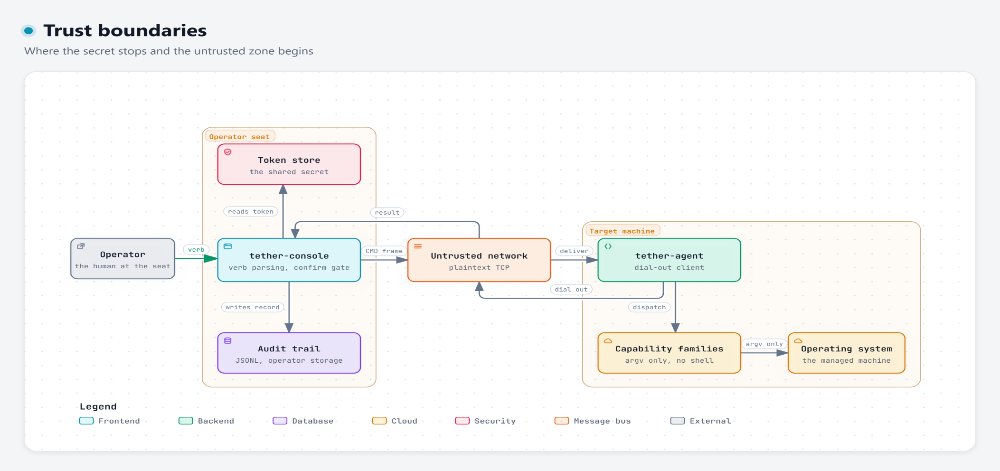
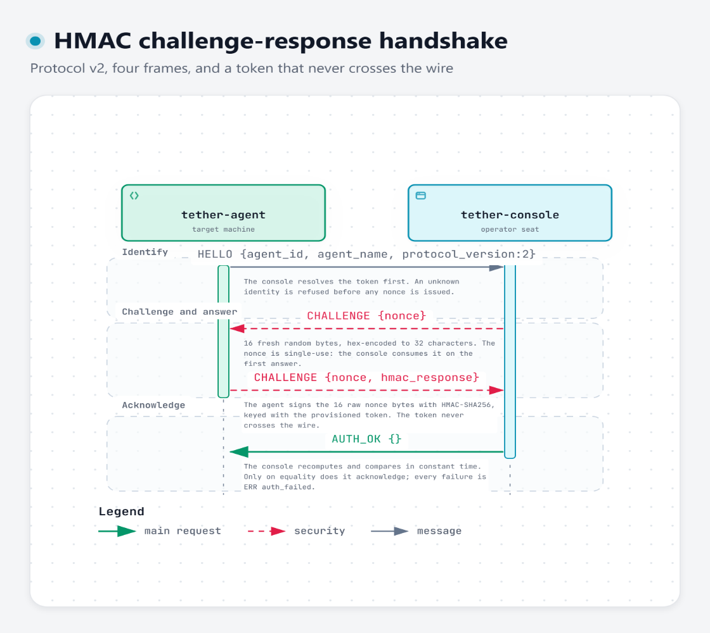

# Security model

What tether protects, how, and — just as importantly — what it does not
protect.

tether is an **authorized-use lab tool**. It may only drive machines the
operator owns or is explicitly authorized to administer. The policy record
lives in [readiness-decisions.md](readiness-decisions.md).

---

## 1. Assets

| Asset | Where it lives | Threat |
| --- | --- | --- |
| The pre-shared agent token | The console's token store and the agent's config file | Disclosure allows impersonation of that agent |
| The agent's identity | The `HELLO` frame | Spoofing an identity |
| Command traffic | The session | Injection or reinterpretation of a command |
| Command arguments | The `CMD` payload | Shell injection |
| The operator's action history | The audit trail | Tampering or omission |
| The target machine's state | The agent's capabilities | Unintended or destructive change |

---

## 2. Trust boundaries

*Interactive version: [trust-boundaries.html](diagrams/trust-boundaries.html).*

**The untrusted zone is everything between the two processes.** The token is
the only thing that must not cross it.

---

## 3. Authentication

### The handshake

A four-step HMAC-SHA256 challenge-response over a pre-shared token:

*Interactive version: [handshake.html](diagrams/handshake.html).*

### Properties

| Property | How it is achieved |
| --- | --- |
| The token never crosses the wire | Only the agent's *knowledge* of it is used. The console never sends it; the agent never sends it. |
| The token is never logged | The agent's startup log omits it explicitly; the console never logs tokens. |
| Replay is refused | The nonce is single-use. A `Challenger` holds exactly one outstanding nonce and consumes it on the first answer, whatever the outcome. |
| An unknown identity learns nothing | The console resolves the token **before** issuing any challenge. No nonce is ever issued to an unknown identity. |
| A wrong token cannot be brute-forced online | Each handshake attempt consumes the nonce; a new challenge requires a new connection. |
| The comparison does not leak by timing | `constant_time_equal` accumulates the XOR difference over the full 32 bytes. |
| The nonce is not guessable | 16 bytes from `std::random_device`, hex-encoded to 32 lowercase hex characters. |

### Refusal taxonomy

Every handshake failure becomes `ERR {code: "auth_failed", message: <reason>}`,
and the session goes `Down`. `AUTH_OK` is **never** sent after a failure.

| Reason | Wire message |
| --- | --- |
| `NotBegun` | `answer arrived before any challenge` |
| `UnknownNonce` | `unknown nonce` |
| `NonceReplay` | `replayed nonce` |
| `BadHmac` | `malformed hmac answer` |
| `WrongToken` | `hmac does not verify with the provisioned token` |

> The `code` is always `auth_failed`; the specific reason is **prose** in the
> `message` field. The snake_case reason names above are the internal enum
> values (`HandshakeFailure`), not wire tokens.

---

## 4. Command safety

### Arguments are data, always

Arguments travel as an argv-style JSON array of strings. They are **never**
re-joined into a shell line and **never** handed to a shell:

- Linux: `fork()` + `execvp()` — PATH-searched, never `/bin/sh`.
- Windows: `CreateProcessW` with a hand-rolled MS-CRT quoting routine, and
  `lpApplicationName == nullptr` so the CRT resolves the first token itself.

`;`, `|`, `&`, `>`, `<`, quotes, and backslashes inside an argument are file
names. The matrix suite pins this with
`{"a;b","c|d","e&f","g>h"}` arriving byte-for-byte, and the process suite
pins it against the real per-OS implementations.

### The closed command set

Only 19 verbs exist, matched **exactly and case-sensitively**. Anything else
is refused with `unknown_command` before a single capability is touched. There
is no pass-through, no "run this shell command", and no plugin mechanism.

### Two confirmation gates

Destructive verbs are marked destructive at the **agent** layer: `delete`,
`move`, `copy`, `shutdown`, `restart`. The **console** gate covers a narrower
set — `delete`, `shutdown`, `restart` only.

| Gate | Where | Verb set | What happens without it |
| --- | --- | --- | --- |
| **A — console** | `console/cli.cpp` (`kDestructiveCommands`) | `delete`, `shutdown`, `restart` | The console refuses **locally**: nothing is sent to the agent, exit code 4. Without `--yes`, a non-TTY stdin refuses immediately; a TTY gets a `y/N` prompt on stderr that only accepts `y`/`yes`. |
| **B — agent** | `lib/syscalls/matrix.cpp` (`CommandSpec::destructive`) | all five | The agent refuses **before the capability runs**: `missing_confirmation`, nothing executed. The literal `confirm` token is stripped before the family sees the argv. |

The gates are independent. The console does **not** inject `confirm`. For
`move` and `copy` only Gate B applies — the console dispatches them and the
agent refuses them, so the command still cannot execute unconfirmed.

### Refusals are structured, not exceptions

A refusal that crosses the wire is an `ERR` frame with a stable `code` and a
human `message`. The command fails; **the session stays usable**. This is
pinned by the session suite and the per-family e2e suite: an unsupported
command, a wrong-arity command, and a Wayland refusal all leave the session
able to serve the next command.

### No stealth, no persistence

Every action is an explicit, audit-visible console command. There is no
background beacon, no scheduled task, no hidden collection. The keylogger and
the keyboard lock exist as ordinary verbs with an ordinary audit record.

---

## 5. The audit trail

Set `audit_path` in the console config to turn the trail on.

| Field | Meaning |
| --- | --- |
| `time` | ISO-8601 UTC with milliseconds |
| `time_epoch_ms` | The same instant numerically |
| `agent` | The targeted registry identity |
| `command` | The command word |
| `parameters` | The command parameters, order preserved |
| `seq` | The dispatch seq. **`0` means nothing was dispatched** (a local refusal, a lost session, a transport failure). |
| `outcome` | `executed` \| `refused` \| `failed` |
| `record_type` | `command` \| `job_event` |
| `event` / `job` / `delivered` | Background-job lifecycle fields |
| `detail` | The refusal reason or the failure detail |

- One `command` record per dispatched attempt, plus `job_event` records for
  background-job starts and stops.
- **A write failure is loud.** The console reports it and exits non-zero
  rather than continuing unaudited.
- The store re-opens existing history on construction, so previously persisted
  records are queryable again.
- **Refusal vs failure:** `unknown_command`, `unsupported_platform`,
  `missing_confirmation`, `invalid_args`, `already_running`, and `not_running`
  are recorded as `refused` (no system effect). Every other error code is
  recorded as `failed`.

### What the trail does not cover

- It records the **console's** view. It does not record what happened on the
  agent's host outside a command's own result.
- It does not record the *token*, and it does not record the console's
  configuration.
- It is **append-only by convention, not by enforcement** — protect the file
  with filesystem permissions.

---

## 6. Transport security

| Property | Status |
| --- | --- |
| Encryption in transit | **None.** The protocol is plaintext TCP. The HMAC protects the *handshake*, not the traffic. |
| Agent exposure | The agent **dials out**; nothing on the target listens, so no inbound port is opened on the managed machine. |
| Agent authentication of the console | **Not done.** The agent trusts whatever it connected to. Use a trusted network or a tunnel. |
| Console authentication of the agent | HMAC challenge-response, as above. |
| Replay of a captured handshake | Refused by the single-use nonce — but only *within* one handshake; a captured answer cannot be replayed against a different nonce. |

> **Operational guidance:** run tether on a trusted network segment or inside
> a VPN/tunnel. The protocol's design goal is *authorisation* (who may issue
> commands), not *confidentiality* (what the commands contain). A screenshot
> or a keylog capture crosses the wire in the clear.

---

## 7. Known limitations

These are real, and they are documented rather than hidden.

| # | Limitation | Consequence | Mitigation |
| --- | --- | --- | --- |
| 1 | **No key derivation.** The provisioned token is used verbatim as the HMAC key — no HKDF, no PBKDF2, no salt. | A low-entropy, human-chosen token is vulnerable to an **offline dictionary attack** against a captured `(nonce, hmac_response)` pair: one HMAC = one guess. | Use a **high-entropy random** token (≥ 32 bytes from a CSPRNG). The token store is the operator's responsibility. |
| 2 | **The nonce comes from `std::random_device`**, which is not guaranteed to be a CSPRNG. On some MinGW/libstdc++ configurations it is a deterministic MT19937 — and because a fresh instance is constructed per call, the nonce sequence could repeat across process restarts. | Weak or repeated nonces weaken replay protection. | The token store is the operator's responsibility. The nonce is 16 bytes and single-use within a handshake regardless. |
| 3 | **The HMAC is not bound to the identity, version, or direction.** It covers only the 16 nonce bytes. | An answer is not cryptographically bound to a specific agent identity beyond the console's own token lookup. | Acceptable for the one-token-per-identity model the console enforces. |
| 4 | **No forward compatibility.** A new field on any control type breaks interop; a new envelope version poisons the stream. | A future peer cannot add fields without a coordinated upgrade. | Deliberate: silent version drift is worse than a loud failure. The `protocol_version` byte must equal 2 exactly. |
| 5 | **The console does not authenticate the agent's operator.** Anyone who can reach the console's port and knows the token can drive the agent. | The token store and the network are the boundary. | Protect the token store (`0600`), restrict the listener, and audit. |
| 6 | **The agent's console address is not verified.** The agent dials whatever it is configured to dial. | A hijacked config redirects the agent. | Protect the agent config file. |
| 7 | **An oversized outbound result kills the session.** `encode_frame` throws `OversizePayload` for a > 1 MiB `RESULT_TEXT`, and that propagates out of the delivery path. | One oversized result ends an otherwise healthy session. | The shipped agent shapes anything over 128 KiB into the chunked file channel, so the oversize path is unreachable through the agent today. |
| 8 | **`ConsoleSession::opened_at_` is never assigned.** The console's auth timeout is measured from time 0. | With an absolute clock the auth timeout would fire on the first pump. | The shipped TCP transport rebases the session clock per connection (accept = 0), which masks it. |
| 9 | **The keyboard lock's scope is the X display connection, not the session.** The Linux guard holds the display open while locked, and the `InputControl` is created once for the agent's whole process — so the grab survives session drops and redials. | The lock outlives the session it was taken in. | `unlock_keyboard` releases it explicitly. The grab dies with the display connection — or with the agent process. |
| 10 | **The Gmail adapter's admin list is the only mail-side authorisation.** | A compromised admin address can issue commands. | Keep the admin list short, rotate the OAuth credentials, and read the audit trail. |

---

## 8. Operator checklist

Before pointing tether at a real machine:

- [ ] The token is **high-entropy random**, not a password.
- [ ] The token store and the agent config are mode `0600`, owned by the
      service account.
- [ ] The agent config and the token store agree on the identity **exactly**.
- [ ] The console's listener is bound to a trusted interface, or the whole
      path is inside a tunnel.
- [ ] `audit_path` is set, and the audit file is on durable storage.
- [ ] The audit trail is being read.
- [ ] You understand that **the traffic is plaintext** and that screenshots and
      keylog captures cross the wire in the clear.
- [ ] The `gmail` section is `null` unless you actually want the mail slow
      path — it is off by default.
- [ ] Destructive commands are used with both confirmations, deliberately.

---

## 9. Verifying the policy in the tree

The policy is checked by `git grep` over the tracked tree. The verification
record — the searches run and their results — is in
[readiness-decisions.md § "Allowed-use policy results"](readiness-decisions.md).

Summary of the last verification (2026-10-21):

| Search | Result |
| --- | --- |
| Retired v1 admin addresses | **None** in the tracked tree (they survive only in git history, behind the `v1.0-final` tag). |
| `admin.txt` | No such **file** exists. The literal appears only in prose: inside `openspec/**` describing its retirement, and inside this documentation set and `docs/readiness-decisions.md` quoting the record. |
| Credential-shaped strings | Only OAuth *field names* and fabricated test values. Real credentials live at operator-configured paths outside the repo. |
| Hardcoded port `12345` | Not hardcoded in source. The literal appears only in prose: `openspec/changes/tether-v2-reset/design.md` and `docs/readiness-decisions.md`, describing v1's retired port. The agent's default dial port 47474 is a config-file default, not source wiring. |
| High-entropy literals | The RFC 4231 HMAC vector, the base64 alphabets, and fabricated test tokens — no secrets. |

**Any tree change that reintroduces a literal address or a secret is a policy
violation, not a refactor.**
